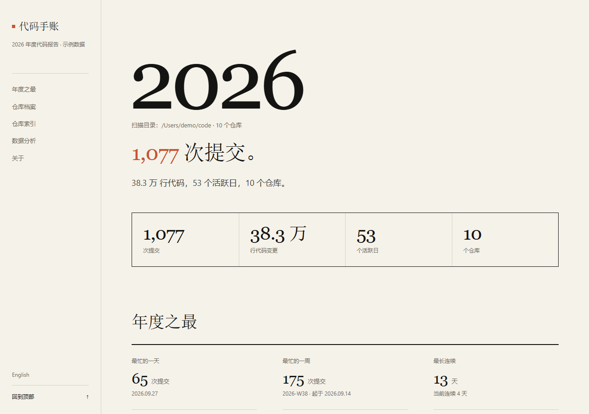
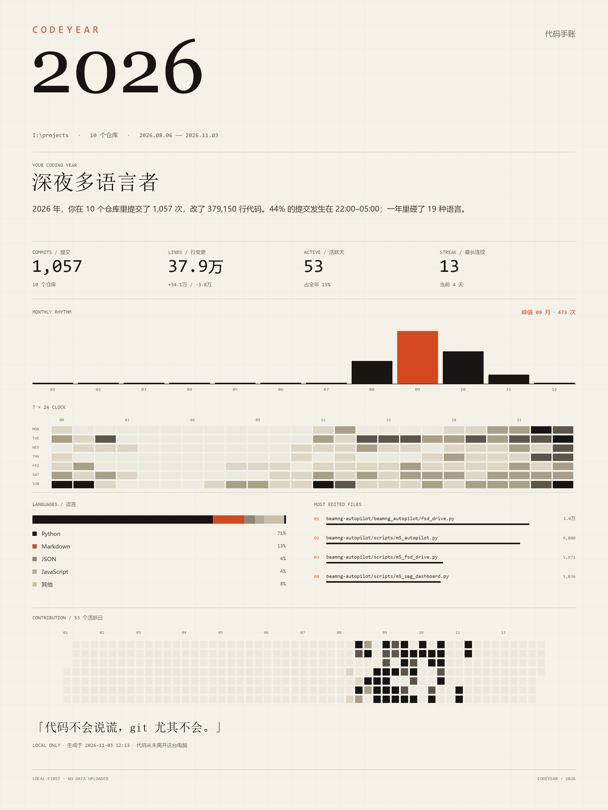
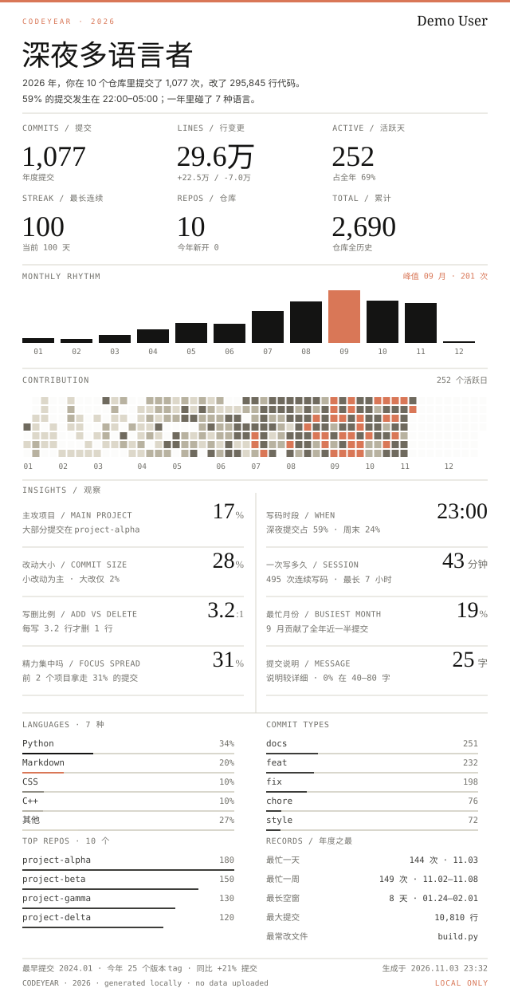

# CodeYear · A Local-First Coding Yearbook

[](https://github.com/Qiongkura/codeyear/actions/workflows/ci.yml)
[](https://github.com/Qiongkura/codeyear/releases/latest)
[](https://www.python.org/)
[](https://qiongkura.github.io/codeyear/)

**English** | [简体中文](README.md)

> Scan the git repositories on your own machine and turn them into a yearbook that belongs to you:
> a bilingual paper-archive HTML report, a 2400×3200 poster, a 2400×5330 long image, and a
> theme-aware GitHub profile card. Local-first by default — no sign-in, no upload. The public
> GitHub mode is an opt-in network feature.



**Live demo**: [https://qiongkura.github.io/codeyear/](https://qiongkura.github.io/codeyear/)

**Sample reports**: [Chinese](docs/sample-report.html) · [English](docs/sample-report-en.html) — anonymized demo data; open either directly in a browser.

## Download / install

**Windows (no Python required)**: download `CodeYear.exe` from
[Releases](https://github.com/Qiongkura/codeyear/releases/latest), double-click it,
and choose your projects folder.

**Developers**:

```bash
pip install git+https://github.com/Qiongkura/codeyear.git
codeyear
```

Or install the wheel from the release:

```bash
pip install https://github.com/Qiongkura/codeyear/releases/download/v0.2.2/codeyear-0.2.2-py3-none-any.whl
```

> The exe is unsigned; Windows SmartScreen may warn. Click “More info → Run anyway”.
> On macOS / Linux use the wheel or run from source.

## 30-second quick start

Requires Python 3.9+ and Git. Replace `~/code` with the folder that contains your projects (not the CodeYear repo itself):

```bash
git clone https://github.com/Qiongkura/codeyear.git
cd codeyear
pip install -r requirements.txt
python -m codeyear scan ~/code --open
```

Or run it in one line with uv (install [uv](https://docs.astral.sh/uv/) first):

```bash
uvx --from git+https://github.com/Qiongkura/codeyear.git codeyear scan ~/code --open
```

On Windows use a path such as `C:\code`. The report goes to `codeyear-output/`; `--open` opens the HTML.

## Desktop GUI / terminal wizard

Prefer clicking? Run:

```bash
codeyear
```

This opens a desktop window: add multiple folders, check the repository count, watch progress, choose the output folder, and open the report when done.
On Windows you can also double-click `CodeYear.cmd` in the repo root.

Tkinter is required; it ships with Python on Windows/macOS. On Linux install `python3-tk`.
After installing the package, `codeyear-gui` works too.

Prefer the terminal?

```bash
codeyear tui
```

The terminal wizard supports the same folders, repository count, progress bar, and output folder.

## Public GitHub mode (opt-in network)

If you do not want to scan local repositories first, try a public account:

```bash
codeyear github Qiongkura --year 2026 --out ./codeyear-github
```

- Reads public repositories only; private repositories are never touched.
- **Scope:** only public repositories owned by the account (`type=owner`) and commits GitHub can associate with that login. Organization/collaborator repositories and commits from unlinked emails are not counted, and merge commits are excluded. Use local `scan` for the full history.
- Requires network access; fetches up to 200 commit details by default (`--max-commits`).
- Without a token it is capped at 30 commits and is easy to rate-limit; set `GITHUB_TOKEN` or pass `--token`.
- Outputs the full report, poster, long image, cards, and `codeyear-2026-embed.md` for your profile README.
- Card only: add `--card-only` to skip the report, poster, and long image.
- Update the profile repo directly: add `--profile-repo ~/Qiongkura` (local only) or `--push-profile` (commit and push).
- Cross-year automation: add `--fallback-previous` to keep last year's card until the new year has commits.
- Card theme: `--theme paper|mono|forest|ocean`; [theme gallery](docs/themes.md).
- The local `scan` command remains the default; your code is not uploaded.

### Online card service

```bash
codeyear serve --port 8000
```

Open `http://127.0.0.1:8000`, enter a username, and get a card; the service uses a one-hour LRU cache and per-IP rate limiting.

Deploy to Render / Railway / Fly / a VPS: set `GITHUB_TOKEN` and run:

```bash
codeyear serve --host 0.0.0.0 --port $PORT --max-commits 500
```

The repo includes `Dockerfile` and `render.yaml`; Render can detect it directly. The image is also published to GHCR
(the package is private by default — set it to Public in GitHub Package settings for anonymous pulls):

```bash
docker run -p 8000:8000 -e GITHUB_TOKEN=your_token ghcr.io/qiongkura/codeyear:latest
```

```text
https://your-host/card.svg?username=Qiongkura&year=2026
https://your-host/card-dark.svg?username=Qiongkura&year=2026
```

`--max-commits` is the number of commit details fetched per request, not a GitHub total.
Each detail is one API call; the default is 200, and without a token it drops to 30.
Raise it with a token for fuller data; use local `scan` for complete history.

[](https://render.com/deploy?repo=https://github.com/Qiongkura/codeyear)

If you only have Cloudflare, expose the local service with a tunnel:
[Cloudflare Tunnel setup](docs/cloudflare.md).

> Both the Action and the hosted service use public GitHub data only. To auto-update
> a local card that includes private repositories, use a local scheduled task or a
> self-hosted runner.
>
> The Action inserts the card block into the profile README automatically (including
> the first run) and uses versioned filenames to bypass GitHub's image cache. It runs
> daily at 04:00 UTC by default; change the workflow `cron` to weekly (`0 4 * * 1`)
> or monthly (`0 4 1 * *`). `--fallback-previous` keeps last year's card until the
> new year has commits. The template installs the release wheel; bump
> `CODEYEAR_VERSION` (currently `0.2.2`) when upgrading.

GitHub Action template: [docs/codeyear-card.yml](docs/codeyear-card.yml).

Usage:

1. Create `.github/workflows/codeyear-card.yml` in `<username>/<username>`
2. Paste the template
3. Run `Update CodeYear card` once from the Actions tab

After that it updates on the cron schedule. The card block is inserted automatically
and old-year references are replaced.

## What it is

CodeYear is a year-in-review for developers. Official Wrapped-style reports usually cover only public data and require authorization, while most of our code lives in private repositories, company intranets, or Gitee. CodeYear reads `.git` on your machine, so private projects, offline environments, and work laptops all work.

By default it counts only commits authored by you (matching git `user.name` / `user.email`) and merges copies of the same project (`work/`, `backup/`, forks) so nothing is double-counted.

## What's in the report

**Yearly records**
- Busiest day/week, longest streak, longest gap, largest single commit, longest commit message
- Time and repository of the first and last commit

**Repository profiles** (top 3 by commits)
- Commits, line changes, main languages, first → latest commit
- Most-edited file, three recent real commits
- Description taken from the first line of the repository README

**Full repository index**
- One-line README summary, stack, own code, latest commit, activity status
- Filter by main language and search by keyword; repositories without a README are marked honestly

**Data analysis**
- Monthly rhythm, 7×24 commit clock, full-year heatmap
- Code composition by lines, language breakdown, **quarterly language shifts**
- Commit-size distribution, commit types, keywords, **message-length distribution**
- Add/delete ratio (including the repo with the most deletions), **coding sessions** (commits within 2 hours count as one)
- Repository lifecycle Gantt chart, **repo graveyard** (untouched for 30 days)
- Most-edited files (full paths)
- Local repository archaeology: all-time commits, first commit (code age), repositories started this year, version tags (repository scope, shown separately from your personal yearly numbers)
- Year-over-year: `--compare` scans the previous year; the cover shows a summary, and the data section has a 10-metric table plus a 12-month grouped bar chart

**Design**
- Paper archive: warm paper, ink, vermilion accent, large serif headings + monospaced data, square corners, hairlines
- Layout: a book-spine contents rail, an oversized year cover (showing the scanned folders),
  a light four-cell stats table, a "Next" link at the end of every section, scroll-spy navigation,
  and a back-to-top button
- Motion: a quiet page fade plus short hover/active transitions; no scroll bouncing or count-up numbers; respects `prefers-reduced-motion`
- Bilingual: generates both Chinese and English reports from the same data, switchable in-page
- Vanilla JS only; respects `prefers-reduced-motion`
- System fonts only (Georgia / Songti / SimSun + Consolas); no external font requests
- GitHub card: 640×1254 poster layout, transparent background, light/dark variants, hierarchy from type, hairlines, and one terracotta accent
- Eight plain-language insights: main project, coding hours, commit size, session length, add/delete ratio, busiest month, focus spread, commit-message style
- Card themes: paper / mono / forest / ocean; the public card service accepts a `theme` parameter
- The report can be printed or saved as PDF directly from the browser

## Install and outputs

The command above only installs Pillow. To install CodeYear as a global command:

```bash
pip install -e .
codeyear scan ~/code --year 2026 --open
```

Outputs go to `./codeyear-output/` by default:

```text
codeyear-2026.html          Chinese report; open in a browser
codeyear-2026-en.html       English report, same data
codeyear-2026.png           2400×3200 poster (2× render)
codeyear-2026-long.png      2400×5330 full-length image
codeyear-2026-card.svg      640×1254 GitHub profile card (transparent, light)
codeyear-2026-card-dark.svg 640×1254 dark variant (transparent)
codeyear-2026.json          raw statistics for further processing
```

Poster sample (same data):



Full-length sample: [docs/sample-long.png](docs/sample-long.png)

## Put it on your GitHub profile

The scan also produces a light and a dark card, both with transparent backgrounds. Commit both files to your profile repository (the repository named after your username, e.g. `Qiongkura/Qiongkura`) and use `<picture>` in its README to switch by theme:

```md
<picture>
  <source media="(prefers-color-scheme: dark)" srcset="./codeyear-2026-card-dark.svg">
  
</picture>
```

With `<picture>`, GitHub picks the right version for the viewer's theme. If you only use ``, dark mode will show the light card. The card is a static file: re-run the scan and commit to update it.

> GitHub caches README images through its image proxy, so an updated SVG with the same name may still show the old version. When you use `--profile-repo` or the Action below, CodeYear writes versioned filenames and rewrites the README automatically; manual updates still need a rename or query string.

### Update the profile repo automatically

If you have a local clone of your profile repo:

```bash
# Local only — no network
codeyear scan ~/code --year 2026 --profile-repo ~/Qiongkura

# Commit and push after reviewing (network)
codeyear scan ~/code --year 2026 --profile-repo ~/Qiongkura --push-profile

# Cross-year task: keep last year's card until the new year has commits
codeyear scan ~/code --year 2026 --profile-repo ~/Qiongkura --push-profile --fallback-previous
```

`--profile-repo` must be a local clone. Without `--push-profile`, only local files change.
With it, only the card SVGs and profile README are committed; the report and JSON stay local.
Each update writes `codeyear-2026-card-vN.svg`, rewrites the README, and removes older
versions; a new year also replaces the previous year's README reference.

<picture>
  <source media="(prefers-color-scheme: dark)" srcset="docs/sample-card-dark.svg">
  
</picture>

## Only your own commits

- Reads your global `git config user.name` / `user.email` and keeps only commits authored by you.
- To count everyone: add `--all-authors`.
- To pick an author explicitly: add `--author "you@example.com"`.
- Copies of the same project (same `remote` or same first commit) keep only the copy with the most commits.
- "All-time commits" and "first commit" use repository scope: every local repository after deduplication, without author filtering. Yearly commit counts still include only your own commits.
- Commits made with another email/name may be filtered out; use `--author` or `--all-authors` to override.
- Keep old identities: `--alias "old@example.com"` (repeatable); those commits still count as yours.
  The GUI has the same field under “旧邮箱/名字”, comma-separated.

## Common options

| Option | Description |
| --- | --- |
| `--year 2026` | Year to report; defaults to the current year |
| `--out ./out` | Output directory |
| `--author "you@example.com"` | Only count the matching git author |
| `--all-authors` | Count every author (default: only you) |
| `--compare` | Also scan last year and show deltas (roughly doubles scan time) |
| `--fallback-previous` | Keep last year's report/card when the requested year has no commits |
| `--alias "old@example.com"` | Extra author email/name, repeatable |
| `--max-depth 6` | Maximum folder depth per root to search for repositories |
| `--timeout 300` | Per-repository timeout in seconds |
| `--jobs 4` | Scan this many repositories in parallel |
| `--no-png` / `--no-html` | Skip one of the outputs |
| `--no-long` | Skip the full-length image (generated by default) |
| `--no-card` | Skip the GitHub profile card |
| `--profile-repo PATH` | Write the card and README into a local profile repo (no network) |
| `--push-profile` | Commit and push the profile repo after updating (network) |
| `--open` | Open the report when done |
| `--quiet` | Suppress scan progress |

Examples:

```bash
# One repository only
codeyear scan . --year 2026

# Multiple repositories with an explicit author
codeyear scan D:\code --year 2026 --author "you@example.com"

# Include teammates' commits
codeyear scan D:\code --year 2026 --all-authors

# Multiple roots
codeyear scan D:\work E:\oss --year 2026

# Compare with last year
codeyear scan D:\code --year 2026 --compare
```

## Privacy

- The default `scan` mode runs entirely locally with **no network requests**.
- `github`, `serve`, and `--push-profile` are optional network features; they only read public GitHub data or push cards, and never upload local code.
- The local mode reads only `git log`, `git tag`, the first line of each repository README, and `git remote`; no other workspace files.
- Output files are ignored by `.gitignore` by default.
- Local reports say `LOCAL ONLY · no data uploaded` in the footer; public-mode reports label their public data source.
- On git's `dubious ownership` error (common with copied repositories), it retries with `safe.directory` for that repository only; your global git config is never changed.

## Known limitations

- Merge commits are excluded (`--no-merges`).
- Uses author date (`%ad`); in cross-timezone teams, the committer's local time wins.
- Binaries, images, lockfiles, and build artifacts are excluded from language/file statistics.
- A commit that appears in multiple repositories is counted once.
- "Own code" counts non-empty lines and excludes third-party libraries, generated projects, and model directories; the report's "About this report" section states the exact scope for each project.

## How it works

For each repository:

```text
git log --since=2026-01-01 --until=2027-01-01 \
  --pretty=format:%H%x1f%ad%x1f%ae%x1f%an%x1f%s \
  --numstat --no-renames --no-merges
```

Then:

1. Filter by author identity and keep only your commits.
2. Deduplicate by commit hash and merge copies by project lineage.
3. Aggregate by day, hour, weekday, quarter, language, and file.
4. Render the paper report, poster, long image, and profile card.

Languages are mapped from file extensions. Lockfiles, build artifacts, images, and binaries are filtered out so `package-lock.json` does not win "most-edited file".

## Roadmap

- [x] Paper-archive HTML report with motion
- [x] Only your commits (`--all-authors` to opt out)
- [x] Merge project copies by lineage
- [x] Yearly records / 7×24 clock / coding sessions / quarterly languages / repo graveyard
- [x] Paper-themed PNG poster
- [x] Theme-aware GitHub profile card (light/dark, transparent)
- [x] Year-over-year comparison (cover summary + data panel)
- [ ] File-level deletions (most-deleted files)
- [x] PyInstaller exe / desktop shell
- [x] English README
- [x] English HTML report
- [x] Optional profile sync (local or push)
- [x] Daily GitHub profile card update (Action)
- [x] Interactive wizard (multiple folders, repo count, progress, output location)
- [x] Desktop GUI (Tkinter, double-clickable)
- [x] Public GitHub mode (username in, report out)
- [x] Public card service (Render / Docker / Cloudflare Tunnel)
- [ ] Public Gitee mode
- [x] Card themes (paper / mono / forest / ocean)
- [x] Repository search and print styles
- [x] Multi-root CLI
- [x] pytest suite + GitHub Actions CI
- [x] Parallel scanning (`--jobs`)
- [x] Old identity aliases (`--alias`)

## Development

```bash
# Generate a report locally
python -m codeyear scan I:\projects --year 2026 --out ./out

# Syntax check
python -m compileall -q codeyear

# Tests
pip install -e ".[dev]"
pytest -q
```

Code layout:

```text
codeyear/
  scanner.py      find repositories + parse git log + README first line
  stats.py        aggregation / identity filtering / copy merging / metrics
  keywords.py     commit keyword extraction
  languages.py    extension → language mapping and filters
  html_report.py  paper-archive HTML report (inline CSS/JS)
  report_theme.py new report theme / English edition
  card.py         GitHub profile card
  poster.py       PNG poster (Pillow)
  personas.py     coding persona
  github_public.py public GitHub data mode
  runner.py       shared scan + render pipeline (GUI/wizard)
  gui.py          Tkinter desktop GUI
  wizard.py       terminal wizard
  server.py       public card HTTP service
  profile.py      local / pushed profile card sync
  cli.py          command line
```

## License

MIT
