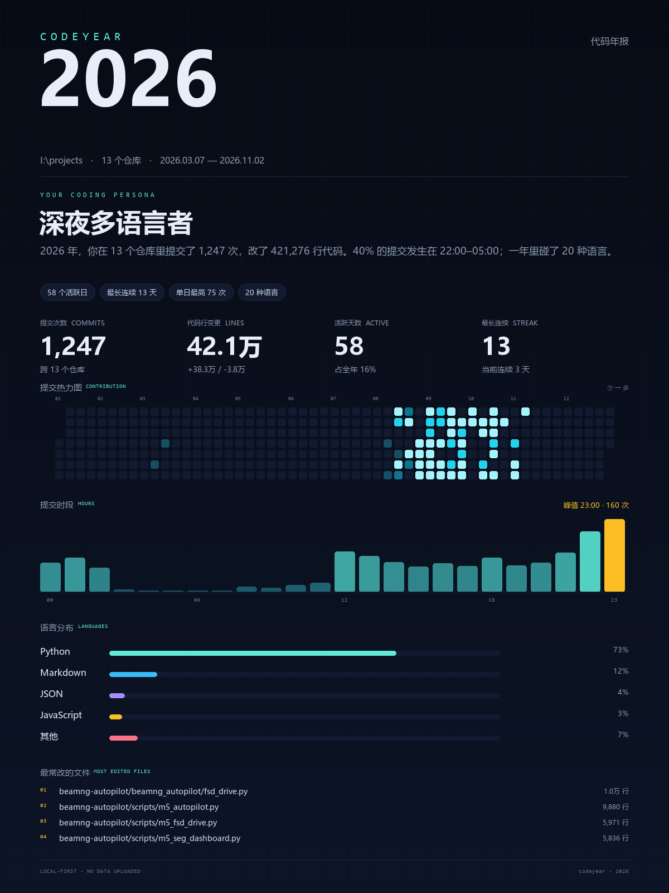

# CodeYear · 代码年报

> 选一个文件夹，扫描你所有的本地 git 仓库，生成一份"代码手账"：纸面档案风格的
> HTML 报告 + 一张可分享的年度海报。只读本地 git，不登录、不上传、不调任何云服务。



**HTML 报告是"工程手账"风格**（示例：[docs/sample-report.html](docs/sample-report.html)）：
仓库档案（时间线 + 热区）、全部仓库索引（简介直接取自各仓库 README 第一行）、
数字图表、全年热力图，以及一条由你自己真实 commit message 组成的跑马灯。
数据 100% 来自本机，页面没有任何第三方 JS。

## 它是什么

CodeYear 是给开发者做的「年度报告」：把散落在各个仓库里的提交，汇总成一张
**1200×1600 的 PNG 海报**和一份**可以滚动浏览的 HTML 报告**。

官方年度报告通常只覆盖公开数据、还要授权；而大多数人的代码在私有仓库、公司内网
或 Gitee。CodeYear 直接读你本机的 `.git`，所以私有项目、离线环境、公司电脑都能用。

它会统计：

- 提交次数、代码行变更（新增 / 删除）、活跃天数、最长连续提交
- 全年贡献热力图（53×7）
- 24 小时提交分布、星期分布
- 语言分布、最常改的文件、仓库排行
- 提交关键词、Conventional Commits 类型
- 一个有点好玩的「代码人格」，比如 **深夜修补匠**、**周末建筑师**
- 自动按 commit hash 去重：同一个项目的备份、快照、worktree 副本不会重复计数

## 快速开始

需要 Python 3.9+、Git，以及 Pillow：

```bash
pip install -r requirements.txt

# 在项目根目录（和 codeyear/ 同级）运行
python -m codeyear scan I:\projects --year 2026 --open
```

或者安装成命令：

```bash
pip install -e .
codeyear scan I:\projects --year 2026 --open
```

输出默认在 `./codeyear-output/`：

```text
codeyear-2026.html   可直接在浏览器打开，滚动查看
codeyear-2026.png    1200×1600 海报，直接发图
codeyear-2026.json   原始统计数据，方便二次开发
```

## 常用参数

| 参数 | 说明 |
| --- | --- |
| `--year 2026` | 统计年份，默认今年 |
| `--out ./out` | 输出目录 |
| `--author "your@email"` | 只统计匹配的 git author |
| `--max-depth 6` | 向下扫描仓库的最大深度 |
| `--no-png` / `--no-html` | 只生成其中一种 |
| `--open` | 生成后自动打开 |
| `--quiet` | 不打印扫描进度 |

示例：

```bash
# 只统计某个仓库
codeyear scan . --year 2026

# 多仓库 + 指定作者
codeyear scan D:\code --year 2026 --author "you@example.com"
```

## 隐私

- 所有统计都在本地完成，**没有任何网络请求**。
- 只读 `git log`，不修改仓库，不读取工作区文件。
- 输出文件默认忽略在 `.gitignore` 里。
- 海报和 HTML 底部会标明 `LOCAL-FIRST · NO DATA UPLOADED`。
- 如果遇到 git 的 `dubious ownership`（常见于拷贝来的仓库），CodeYear 只对当前
  仓库做一次 `safe.directory` 重试，不会改你的全局 git 配置。

## 已知限制

- 只统计 `--no-merges` 的提交；合并提交本身不计入。
- 使用 author date（`%ad`），跨时区协作时日期以提交者本地时间为准。
- 二进制、图片、锁文件和构建产物不参与语言/文件统计。
- 同一个 commit 出现在多个仓库时只计一次，选择提交数最多的那个仓库归属。

## 工作原理

对每个仓库执行一次：

```text
git log --since=2026-01-01 --until=2027-01-01 \
  --pretty=format:%H%x1f%ad%x1f%s --numstat --no-renames --no-merges
```

然后按天、按小时、按语言、按文件聚合。语言根据扩展名映射；锁文件、构建产物、
图片和二进制会被过滤掉，避免 `package-lock.json` 抢走「最常改的文件」。

## 路线图

- [ ] GitHub / Gitee 公开数据模式（输入用户名即可生成，不用下载仓库）
- [ ] 多年度对比（2025 vs 2026）
- [ ] Tauri / Electron 桌面壳，双击即用
- [ ] 自定义海报主题和配色
- [ ] 终端 ASCII 版，SSH 里也能看

## 开发

```bash
python -m codeyear scan I:\projects\my-profile --year 2026 --out ./out
```

代码结构：

```text
codeyear/
  scanner.py      找仓库 + 解析 git log
  stats.py        聚合统计 / 人格
  keywords.py     提交关键词提取
  languages.py    扩展名 → 语言映射与过滤
  html_report.py  HTML 报告
  poster.py       PNG 海报（Pillow）
  cli.py          命令行
```

## License

MIT
