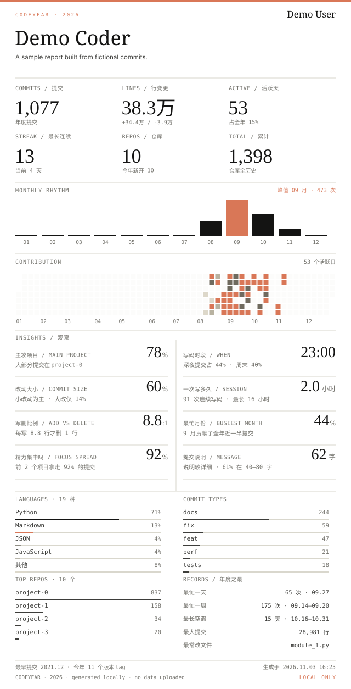
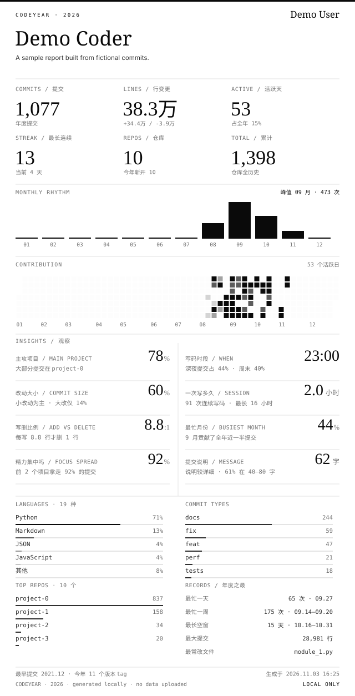
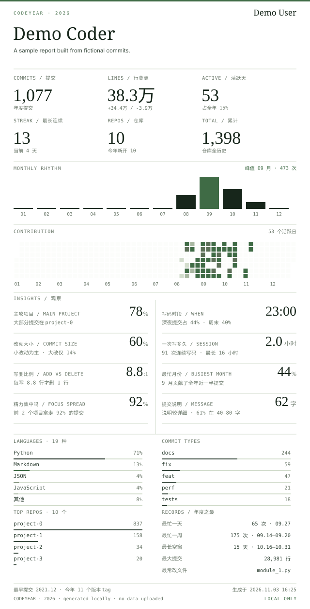
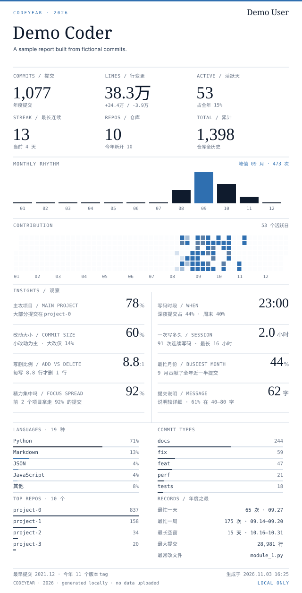

# CodeYear 卡片主题

同一份示例数据，四种主题。每张卡片都有浅色/深色版本，GitHub 会按主题自动切换。

## paper · 纸色

<picture>
  <source media="(prefers-color-scheme: dark)" srcset="theme-paper-dark.svg">
  
</picture>

## mono · 黑白

<picture>
  <source media="(prefers-color-scheme: dark)" srcset="theme-mono-dark.svg">
  
</picture>

## forest · 森林

<picture>
  <source media="(prefers-color-scheme: dark)" srcset="theme-forest-dark.svg">
  
</picture>

## ocean · 海洋

<picture>
  <source media="(prefers-color-scheme: dark)" srcset="theme-ocean-dark.svg">
  
</picture>
